<picture>
  <source media="(prefers-color-scheme: light)" srcset="./assets/michael-os-light.svg">
  
</picture>

<p align="center">
  <a href="https://michaelalexander.vercel.app"></a>
  <a href="https://www.linkedin.com/in/michaelaxander/"></a>
  <a href="https://github.com/LexterMorgan?tab=repositories"></a>
</p>

### `01 / whoami`

I'm Michael Alexander, a Data Science graduate from **Universitas Pembangunan Nasional “Veteran” Jawa Timur**, based in Jakarta, Indonesia.

I turn messy business data into metrics, dashboards, and small tools people can use. I use SQL and Python to investigate patterns, then make the result clear enough to support a decision.

My current focus sits across customer behavior, retail performance, business intelligence, and practical AI-assisted development. I'm also building grounded AI tools — starting with retrieval over saved research in Trendora — that answer from cited sources, not from memory.

### `02 / toolkit`

```text
~/toolkit
|
+-- data and analysis ... Python · Pandas · NumPy · SQL · Excel
+-- databases ........... PostgreSQL · MySQL · SQLite · SQLAlchemy
+-- dashboards .......... Power BI · Tableau · Matplotlib · Recharts
+-- development ......... React · Vite · Express · Next.js · TypeScript · Git
+-- ai and llm .......... FastAPI · Supabase · LLM routing (9router) · RAG over saved reports (in progress)
'-- delivery ............ GitHub Actions · Vercel
```

**Methods**

Data cleaning · ETL · data modeling · KPI design · cohort analysis · retention analysis · dashboard design

### `03 / capability map`

```text
signal
|
+-- customer ........ retention, cohorts, segmentation
+-- retail .......... market position, category performance, trend checks
+-- operations ...... KPI definitions, quality checks, repeatable reporting
+-- ai .............. grounded retrieval, cited answers, small AI tools
'-- product ......... interactive dashboards, small tools, useful exports
```

### `04 / data loop`

```text
question
  |
  +-- source ....... understand origin, scope and gaps
  +-- clean ........ check types, duplicates and missing values
  +-- model ........ define grain, joins and business metrics
  +-- analyze ...... compare patterns and test explanations
  '-- communicate .. explain findings and their limits
```

### `05 / working with AI`

I use AI to explore ideas, work through unfamiliar code, and iterate on products. I give it clear context, inspect its output, and return to source data or documentation when the answer needs proof.

```text
~/ai-workbench
|
+-- plan .......... define the question and constraints
+-- build ......... prototype the smallest useful version
+-- test .......... run the code and check the numbers
'-- verify ........ inspect sources, assumptions and edge cases
```

### `06 / current queue`

```text
~/current-queue
|
+-- shipping ...... small data products and polished dashboards
+-- maintaining ... Trendora and Montara
+-- building ...... retrieval over saved reports in Trendora (in progress)
+-- learning ...... grounded AI tools and reliable AI-assisted development
'-- open .......... AI engineer and data analyst conversations
```

### `07 / contribution signal`

<picture>
  <source media="(prefers-color-scheme: dark)" srcset="https://raw.githubusercontent.com/LexterMorgan/LexterMorgan/output/github-contribution-grid-snake-dark.svg">
  <source media="(prefers-color-scheme: light)" srcset="https://raw.githubusercontent.com/LexterMorgan/LexterMorgan/output/github-contribution-grid-snake.svg">
  
</picture>

### `08 / connect`

I'm open to conversations about data analysis, business intelligence, dashboards, grounded AI tools, and useful small products.

[Portfolio](https://michaelalexander.vercel.app) · [LinkedIn](https://www.linkedin.com/in/michaelaxander/)

<!-- Pinned repositories below this README carry the project showcase. -->
